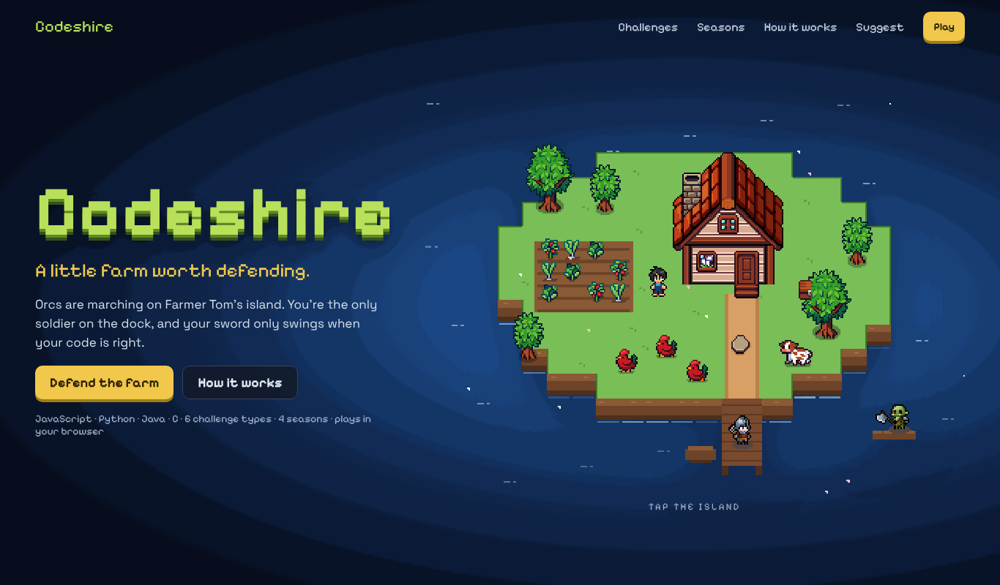
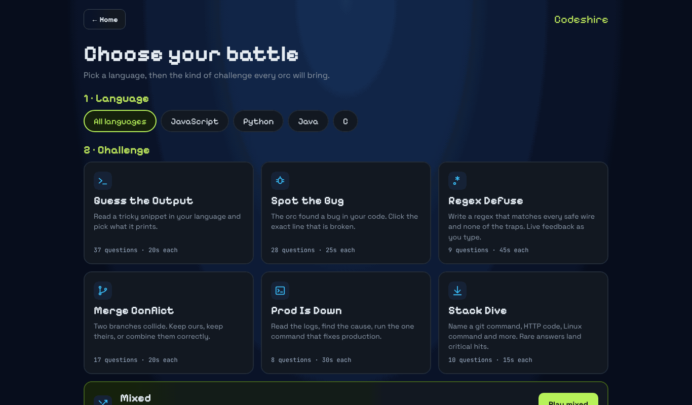
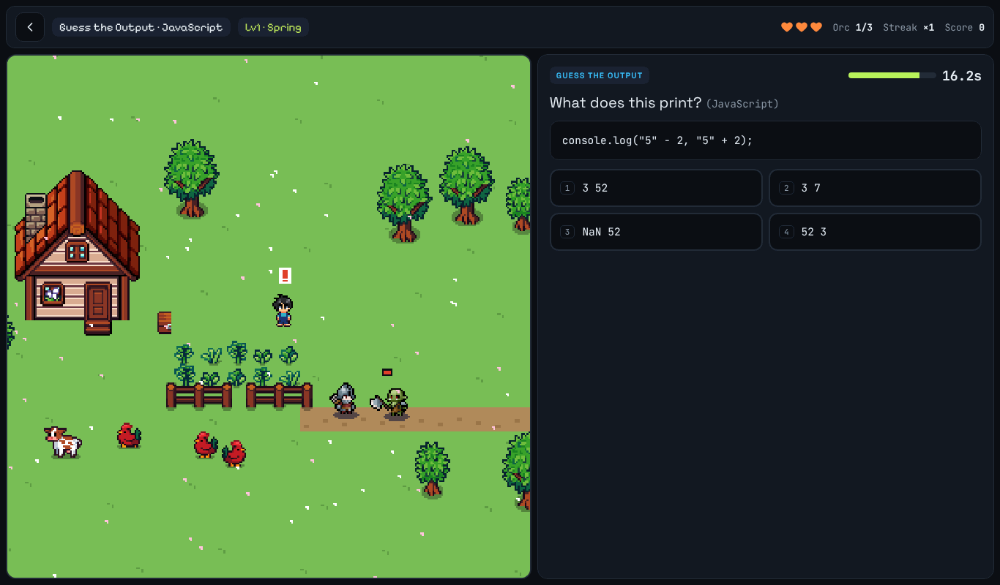
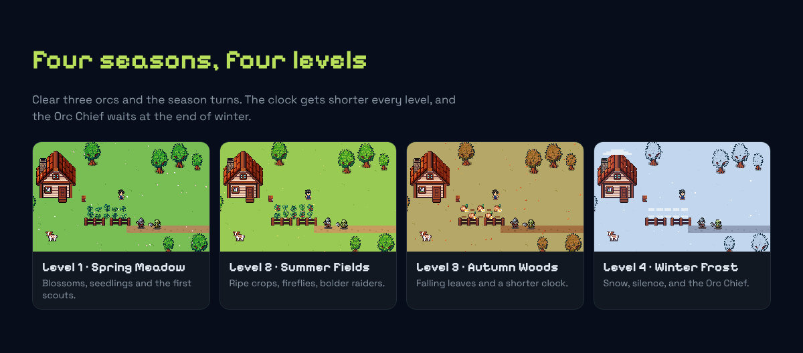
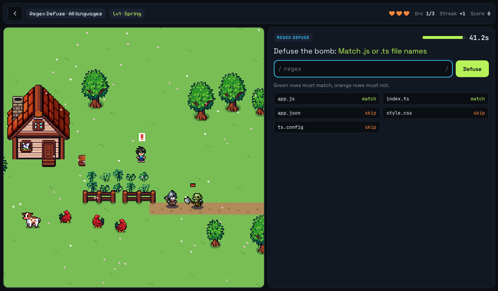
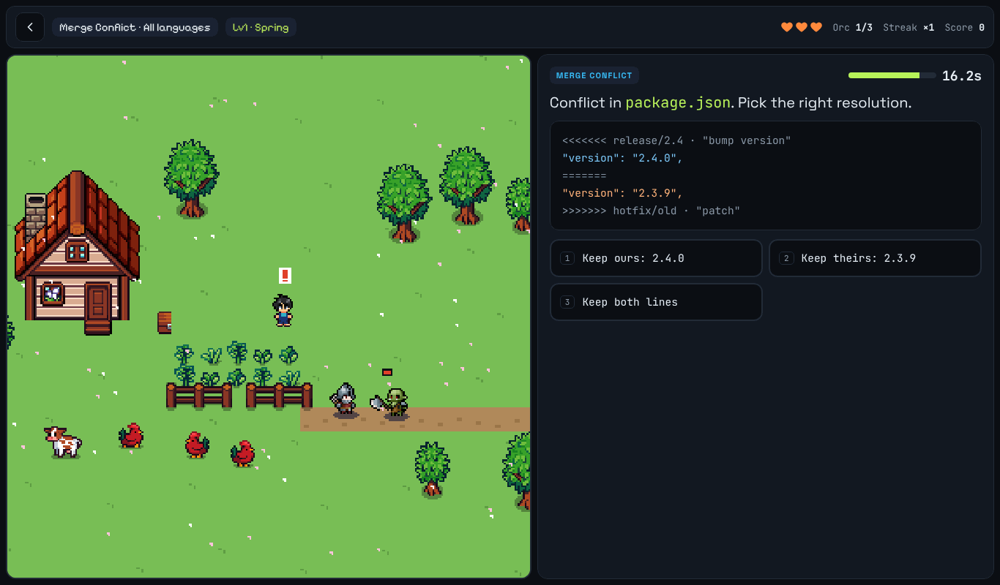
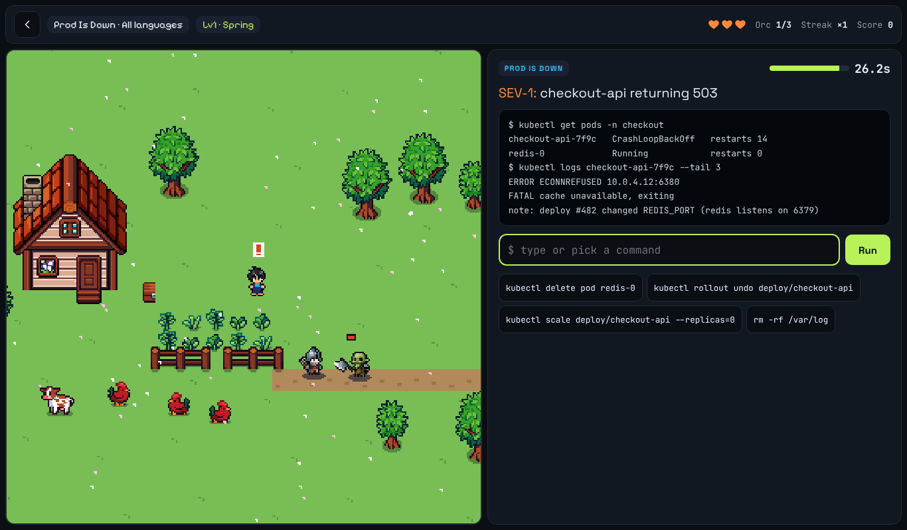

# Codeshire: Farm Defense

**A pixel-art coding game that runs in your browser.** Orcs are marching on Farmer Tom's island.
You are the only soldier on the dock, and your sword only swings when your code is right.

Each orc that reaches you brings a programming challenge. Answer correctly before the timer runs
out and you strike; answer wrong (or too slowly) and you lose a heart. Survive four seasons and
defeat the Orc Chief to save the farm.

- **Languages:** JavaScript, Python, Java, C, or all of them mixed
- **6 challenge types** plus a Mixed mode
- **4 levels** (Spring → Summer → Autumn → Winter), each with its own art and weather
- No accounts, no database, no saved progress: lose, and you start again



---

## How to play

### 1. Choose your battle

Pick a language, then the kind of challenge every orc will bring. Challenge cards show how many
questions are available for the language you picked and how long you get to answer each one.



### 2. Defend the farm

The battlefield is on the left and the question appears on the right when an orc reaches you.
The top bar shows your **hearts**, which **orc** of the level you're on, your **streak** and your **score**.



### 3. Survive the seasons

Clear three orcs and the season turns. Every level shortens the timer
(×1 → ×0.9 → ×0.8 → ×0.7), and the last orc of winter is the **Orc Chief**, who needs two correct
answers to bring down. Each season you clear gives back a heart.



---

## The challenge types

| Type | Time | What you do |
|---|---|---|
| **Guess the Output** | 20s | Read a tricky snippet and pick what it prints. |
| **Spot the Bug** | 25s | Click the exact line that is broken. |
| **Regex Defuse** | 45s | Write a regex that matches every "safe wire" and none of the traps, with live feedback as you type. |
| **Merge Conflict** | 20s | Two branches collide: keep ours, keep theirs, or combine them correctly. |
| **Prod Is Down** | 30s | Read the logs, find the cause, and run the one command that fixes production. |
| **Stack Dive** | 15s | Name a git command, HTTP code, Linux command and more. Rarer answers land critical hits. |
| **Mixed** | varies | A different challenge type for every orc. |

<table>
  <tr>
    <td><br><sub><b>Spot the Bug</b></sub></td>
    <td><br><sub><b>Regex Defuse</b></sub></td>
  </tr>
  <tr>
    <td><br><sub><b>Merge Conflict</b></sub></td>
    <td><br><sub><b>Prod Is Down</b></sub></td>
  </tr>
  <tr>
    <td colspan="2"><br><sub><b>Stack Dive</b></sub></td>
  </tr>
</table>

---

## Scoring

- A correct answer is worth its base points (100, or for Stack Dive: common 50, uncommon 120,
  rare 250, legendary 450) **plus 10 points for every second left on the clock**.
- Consecutive correct answers build a **streak** multiplier: ×1, ×1.25, ×1.5 … up to **×3**.
- A wrong answer or running out of time resets the streak and costs one of your 3 hearts.
  Lose all three and the game is over.

---

## How it works under the hood

Codeshire is deliberately simple: one small PHP page plus static files, and the whole game runs
client-side.

1. **`index.php`** reads `questions.json` from disk, validates it, re-encodes it safely and embeds
   it in the page. It takes no user input and uses no database, sessions or cookies.
2. **`assets/js/app.js`** is the game. It draws the world on an HTML `<canvas>` (sprites, seasonal
   tiles, weather particles, soldier/orc animations), picks questions for the chosen language and
   type, runs the timer, checks answers and keeps score, all in the browser.
   After the page loads, **gameplay makes zero server requests**.
3. **`suggest.php`** is the only endpoint that accepts input: the *Suggestions & credits* form.
   Suggestions are appended to `storage/suggestions.jsonl` (one JSON object per line) and can
   optionally be emailed to you.

### Project structure

```
index.php          the page (PHP 7.4 – 8.3)
suggest.php        receives suggestions from the form
questions.json     ★ all questions + the language list
QUESTIONS-GUIDE.md how to write and edit questions
includes/
  config.php       ★ settings: notification email, storage folder, abuse limits
  bootstrap.php    shared helpers (not web-accessible)
assets/
  css/app.css      styles
  js/app.js        the game
  img/             sprites (farm, soldier, orc, seasonal tiles)
  fonts/           self-hosted fonts + their OFL licences
404.html, robots.txt, favicon.png
docs/screenshots/  images used in this README
```

### Run it locally

You only need PHP 7.4 or newer:

```bash
git clone https://github.com/A6DA99/codeshire.git
cd codeshire
php -S localhost:8000
```

Then open <http://localhost:8000>.

---

## Customising

**Questions:** edit or replace `questions.json`. No code changes are needed. Each question has a
`lang` (a language id, or `"any"` to show it for every language) and fields that depend on its
type. To add a language, add it to the `languages` list and tag questions with its id. A broken
file shows a notice instead of crashing, and a single invalid question is skipped (listed in the
browser console). See **[QUESTIONS-GUIDE.md](QUESTIONS-GUIDE.md)** for every field.

**Settings** in `includes/config.php`:
- `notify_email`: your address, to get an email for each new suggestion.
- `storage_dir`: where suggestions are saved (best kept outside the web root).
- `behind_cloudflare`: set to `true` only if Cloudflare sits in front of the site.
- Limits: 5 suggestions per visitor per hour, 300 per day in total, file capped at 10 MB.

---

## Security

The server side was designed to have nothing to attack:

- `index.php` reads **no user input** and allows only `GET`/`HEAD`. Question data is re-encoded so
  nothing in the file can inject script into the page.
- The suggestion form (`suggest.php`) is protected by a signed, expiring form token (submissions
  under 3 seconds are rejected as bots), a honeypot field, same-site checks, size limits, strict
  field validation, control-character stripping, per-visitor and daily rate limits (IPs are stored
  only as keyed hashes), file locking, and no visitor text in email headers.
- A strict Content-Security-Policy: scripts, fonts and images load only from your own domain, with
  no inline scripts or third-party CDNs.
- In the game, everything a player types is escaped before display, input lengths are capped, and
  invalid regexes are caught.

**Note:** the questions and answers ship to the browser (that's what makes the game instant and
serverless), so a curious player could read them. With no accounts or leaderboard there is nothing
to gain. If a global leaderboard is ever added, answers must be checked on the server.

## Performance

- Each visit is one tiny PHP run plus about 330 KB of static files (cacheable for a year).
- Gameplay itself makes no network requests, so 10 or 10,000 players cost the server the same per visit.
- One small canvas loop that pauses when the tab is hidden; runs fine on phones.

---

## Credits & licences

All sources are also listed on the site's **Suggestions & credits** page.

- Farm art: “Farm RPG: Tiny Asset Pack” (free 16x16), https://maevedevs.itch.io/farm-rpg.
  Summer/autumn/winter tiles are recolours of the free spring pack.
- Characters: “Tiny RPG Character Asset Pack (Free Soldier & Orc)” by Zerie,
  https://zerie.itch.io/tiny-rpg-character-asset-pack
- Fonts: Pixelify Sans, Space Grotesk, JetBrains Mono (SIL Open Font License, included).

Neither art pack shipped a licence file. Check each creator's itch.io page for credit and
commercial-use terms before releasing publicly. Codeshire itself: all rights reserved.
